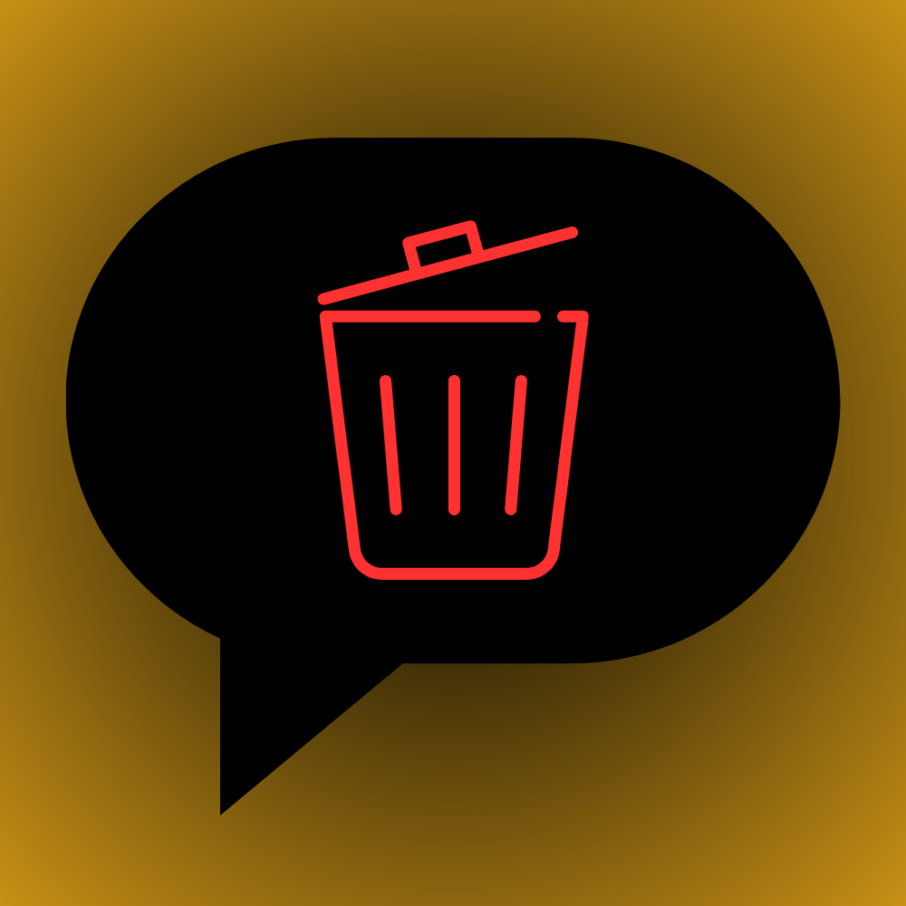

# Disvoke



**Disvoke** is a native Rust desktop application built with `egui` (`eframe`) designed to help you efficiently and safely delete your past messages using a Discord GDPR privacy data pack.

Whether you want to clean up your Direct Messages (DMs) or wipe your history from Discord servers, Disvoke automates the process with minimal memory footprint while respecting Discord's API rate limits.

## Features

- **Lightweight Native UI:** Rebuilt in Rust with `egui`, replacing Electron's Chromium runtime with a single native binary.
- **Comprehensive Deletion:** Delete both Direct Messages (DMs) and Server (Guild) messages parsed directly from your Discord data pack.
- **Smart Rate Limiting & Batch Mode:** Configurable deletion delays, automatic HTTP 429 retry handling, and optional anti-ban batch mode with randomized batch sizes and inter-batch breaks.
- **Resumable Deletion History:** Track deleted message IDs in a JSON file with automatic saving every 20 deletions and skip already-deleted messages in future sessions.
- **Multilanguage Support:** Built-in English and Polish locales, with support for loading additional locale JSON files from `locales/`.
- **Cross-Platform:** Runs natively on Linux, Windows, and macOS.

---

## Getting Started

### Option 1: Download from Releases

Download the pre-built executable for your operating system from the [Releases](https://github.com/Rewindinity/Disvoke/releases) page.

### Option 2: Build from Source

#### Prerequisites

- **Rust toolchain** (Edition 2024 / `rustc` 1.85+ and `cargo`)
- On Linux: standard X11/Wayland and OpenGL development headers, plus GTK3 or xdg-desktop-portal for native file dialogs.

#### Clone and Run

```bash
git clone https://github.com/Rewindinity/Disvoke.git
cd Disvoke
cargo run --release
```

#### Building Release Binaries

You can use `cargo build --release` directly or the helper script `./build.sh`:

```bash
# Build optimized release binary for current host
./build.sh

# Or build directly with Cargo
cargo build --release
```

The compiled executable will be located at `target/release/disvoke` (or `target/release/disvoke.exe` on Windows).

---

## How to Use

1. **Request your Data:** Go to Discord Settings -> Privacy & Safety -> "Request all of my data". Wait for Discord to email you the ZIP file.
2. **Extract the Pack:** Extract the downloaded ZIP file to a folder on your computer.
3. **Get your Token:** Obtain your Discord account authorization token. _(Do not share your token with anyone.)_
4. **Run Disvoke:** Open the app, configure your token and deletion options in **Settings**, and load the extracted data pack folder (or drag and drop it into the window).
5. **Review & Delete:** Filter the messages you want to remove, review the selection, and start the deletion process.

---

## Disclaimer

Automating user accounts (self-botting) is technically against Discord's Terms of Service. Disvoke includes rate-limiting and batch mode options to mitigate risks, but you use this software entirely at your own risk. The developers of Disvoke are not responsible for any account bans, suspensions, or lost data resulting from the use of this application.
